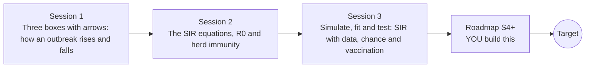

# openepidemic

[](https://github.com/KrunalPanchal1995/openepidemic/actions/workflows/ci.yml)   [](https://colab.research.google.com/github/KrunalPanchal1995/openepidemic/blob/main/sessions/session-01/lesson.ipynb) [](https://krunalpanchal1995.github.io/openepidemic/)

**Fit an outbreak model to noisy data and test vaccination, in three sessions.**

openepidemic teaches the SIR model of an outbreak, from three boxes and two arrows to fitting, chance and vaccination, using only Python and a browser. General education with invented data: not a forecast, not medical advice.

- **Start from zero.** Session 1 needs only school arithmetic: three boxes, two arrows and a curve.
- **See it move.** Every session ships a slider app that runs in the browser, with labelled graphs.
- **Know you got it right.** Each session ends with a checkpoint that prints PASS or FAIL against hand calculations and exact results.
- **Build the missing half.** The repo stops at Session 3 on purpose; the roadmap shows the path to the Target. Synthetic data only; a teaching tool, never a forecast.

[Target](#the-target) · [Who is this for](#who-is-this-for) · [Quick start](#quick-start) · [Sessions](#sessions) · [Roadmap](#roadmap) · [Contribute](#contribute) · [Explainer PDF](docs/explainer.pdf)

> **This repo is incomplete on purpose.** Sessions 1 to 3 are here and fully working. The finished Target below is a preview of what the community can build next. We show you the path, not the code. Sessions 4 and up are yours.

## The Target

An animated synthetic outbreak. On the left, the S, I and R curves of a town are drawn day by day while a vaccination slider sweeps from none upward: the peak of infected people shrinks, arrives later, and finally slips under a dashed hospital-capacity line. On the right, a model is fitted to the first few days of noisy case counts and then to more and more days: the grey fit band is wide and slanted at first (the data cannot tell the contact rate from the recovery rate) and narrows around the true curve as the days arrive. Your goal over the coming sessions: build both halves yourself. All data are invented; this is a teaching animation, not a forecast.


*Target: vaccination shifts the peak (left); the fit band narrows as more days of data arrive (right). Synthetic data.*


*A still from the Target: vaccination sweep and fit band*


*Fit bands with 8, 14, 24 and 60 days of synthetic data*


*Infected curves for several vaccination coverages against the hospital line*

Try it live:

- [Math Visual Studio: ordinary differential equations (Atlas S16)](https://krunalpanchal1995.github.io/studio/#atlas?ch=S16&ex=1)
- [Math Visual Studio: statistics, estimation and regression (Atlas S26)](https://krunalpanchal1995.github.io/studio/#atlas?ch=S26&ex=1)

How the Target was made is shown only as a path in [promo/roadmap.md](promo/roadmap.md).

## Who is this for
**secondary school to diploma / undergraduate (levels 3-5).** Topic area: Biology, Human Body and Health Science.

Prerequisites:

- School arithmetic and percentages; for Sessions 2 and 3, the idea of a rate of change (slope) and the exponential function.
- Python 3.10 or newer; if `python --version` works, you are ready. PRIMER.md explains the rest.
- No biology, GitHub or differential-equation experience is needed. This repo is general education only: it gives no medical advice.

New to Python? Read [PRIMER.md](PRIMER.md) first (10 minutes).

## Quick start

No installation knowledge needed. You need [Git](https://git-scm.com/downloads) and [Python 3.10+](https://www.python.org/downloads/) (Windows: tick "Add Python to PATH"). On Mac and Linux type `python3` wherever this page says `python`.

```bash
git clone https://github.com/KrunalPanchal1995/openepidemic.git
cd openepidemic
python start.py 1
```

`start.py` creates a private environment, installs what is needed and runs Session 1 with its checkpoint. Next: `python start.py 2`, `python start.py 3`, or `python start.py test` to check everything. Only a checkpoint: `python start.py check 1`.

Five lines turn the idea of Session 1 into a result (they work as they are): Save it as `try.py` and run it with `python start.py run try.py` (this uses the private environment, where NumPy is installed):

```python
import numpy as np
S, I, R, N = 999.0, 1.0, 0.0, 1000.0           # susceptible, infected, recovered people
for day in range(120):                          # one crude step per day
    new, rec = 0.5 * S * I / N, 0.25 * I        # new infections, new recoveries
    S, I, R = S - new, I + new - rec, R + rec
print(round(R), 'of', int(N), 'people recovered after 120 days')   # most of the town
```

Every session also opens in your browser with sliders (no install): [live apps](https://krunalpanchal1995.github.io/openepidemic/). Or use the Colab badge above for the notebook.

## Sessions

| # | Session | Model level | Time | Live app |
|---|---|---|---|---|
| 1 | [Three boxes with arrows: how an outbreak rises and falls](sessions/session-01/README.md) | Level 1: conceptual interactive model | 60 min | [open](https://krunalpanchal1995.github.io/openepidemic/session-01/) |
| 2 | [The SIR equations, R0 and herd immunity](sessions/session-02/README.md) | Level 2: mathematical engineering model | 75 min | [open](https://krunalpanchal1995.github.io/openepidemic/session-02/) |
| 3 | [Simulate, fit and test: SIR with data, chance and vaccination](sessions/session-03/README.md) | Level 3: simulation and validation | 90 min | [open](https://krunalpanchal1995.github.io/openepidemic/session-03/) |

Each session follows the same six steps: A real-world problem, B concept and theory, C visual explanation, D interactive simulation, E worked example and experiment, F assessment and design challenge. Each ends with `checkpoint.py`, which prints `PASS` or `FAIL` against reference numbers. Session 3 also contains the real-world mini-project: **Keep a synthetic town under its hospital line**.

## Architecture



| Folder or file | What is inside |
|---|---|
| `sessions/` | three sessions: README (A-F), `lesson.py`, notebook, live app, exercises, activity sheet, checkpoint |
| `promo/` | the Target: media, live links, and the roadmap (path only) |
| `docs/` | `explainer.tex` and the built `explainer.pdf` |
| `tests/` | runs every lesson and checkpoint headless |
| `start.py` | one command to set up and run anything |
| `QUALITY.md`, `RUBRIC.md` | the quality checklist and the scoring rubric |
| `.github/` | CI, PDF build, Pages deploy, issue and PR templates |

## Roadmap

| Milestone | What you will build | Difficulty |
|---|---|---|
| Session 4: Add age groups | A two-group SIR model (for example children and adults) with a 2 by 2 contact matrix and group-specific vaccination. | intermediate |
| Session 5: Add an exposed stage (SEIR) | An SEIR model with latent rate sigma, solved with your RK4. | intermediate |
| Session 6: Fit with a reporting delay and under-reporting | A fit of beta, gamma, delay and reporting fraction to synthetic data that has a 5-day delay. | advanced |
| Session 7: Honest uncertainty with a Bayesian fit | A random-walk Metropolis sampler for beta and gamma with a Poisson likelihood. | advanced |
| Session 8: Target: the animated fit band and vaccination slider | A two-panel animation like the Target, built on your own fitting and RK4 code. | advanced |

Full detail with a checkpoint per milestone: [promo/roadmap.md](promo/roadmap.md).

## Contribute
New to GitHub? Read [CONTRIBUTING.md](CONTRIBUTING.md); it starts from zero. Pick an issue labelled `good first issue`. Translations into Hindi, Telugu, Tamil and Malayalam are welcome.

<details>
<summary>Development</summary>

```bash
python start.py test        # runs every lesson and checkpoint
```
Lessons use `# %%` cell markers so they open as notebooks in VS Code. See [QUALITY.md](QUALITY.md) for the standard every session meets.
</details>

## License
MIT. See [LICENSE](LICENSE). Media in `promo/media` is (c) Krunal Panchal, CC BY 4.0.

## Acknowledgments
Part of the [PAN IIT OSS](https://hellofoss.tech-iitb.org/projects) open-source teaching collection, modelled on the structure of [openspline](https://github.com/openspline/openspline). Built on ideas from the Math Visual Studio at https://krunalpanchal1995.github.io/studio/.
