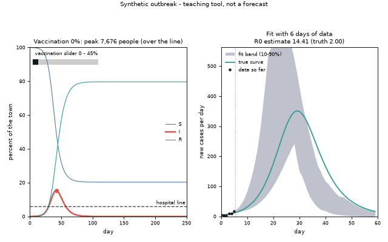
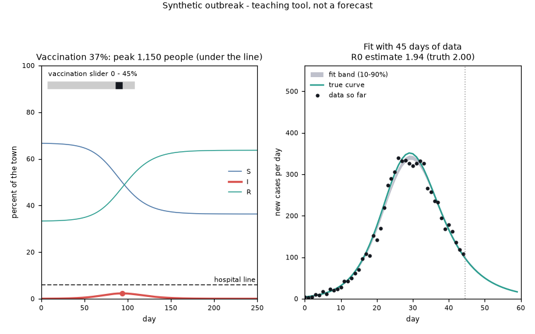
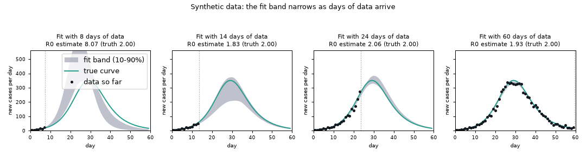
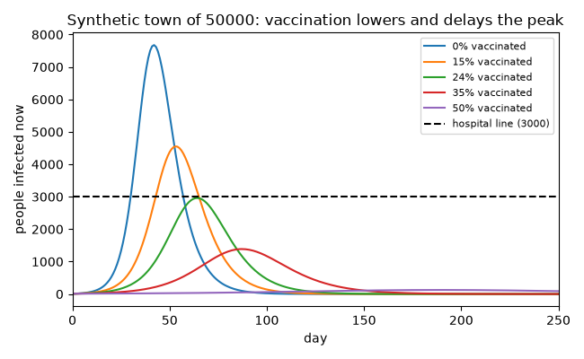

# What you are building toward

An animated synthetic outbreak. On the left, the S, I and R curves of a town are drawn day by day while a vaccination slider sweeps from none upward: the peak of infected people shrinks, arrives later, and finally slips under a dashed hospital-capacity line. On the right, a model is fitted to the first few days of noisy case counts and then to more and more days: the grey fit band is wide and slanted at first (the data cannot tell the contact rate from the recovery rate) and narrows around the true curve as the days arrive. Your goal over the coming sessions: build both halves yourself. All data are invented; this is a teaching animation, not a forecast.

*Target: vaccination shifts the peak (left); the fit band narrows as more days of data arrive (right). Synthetic data.*

*A still from the Target: vaccination sweep and fit band*

*Fit bands with 8, 14, 24 and 60 days of synthetic data*

*Infected curves for several vaccination coverages against the hospital line*

These results come from a private reference build. The code is not published; the roadmap shows the path so you can build your own.

Live links:

- [Math Visual Studio: ordinary differential equations (Atlas S16)](https://krunalpanchal1995.github.io/studio/#atlas?ch=S16&ex=1)
- [Math Visual Studio: statistics, estimation and regression (Atlas S26)](https://krunalpanchal1995.github.io/studio/#atlas?ch=S26&ex=1)
