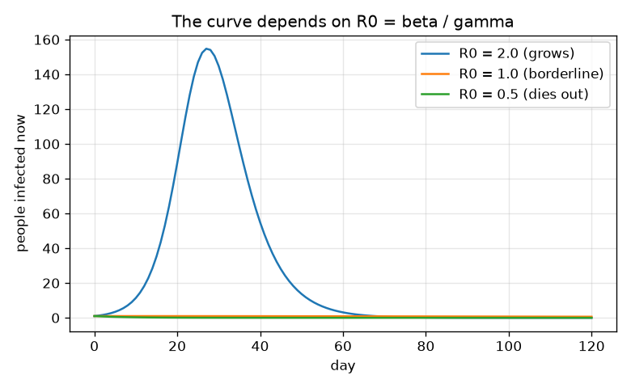
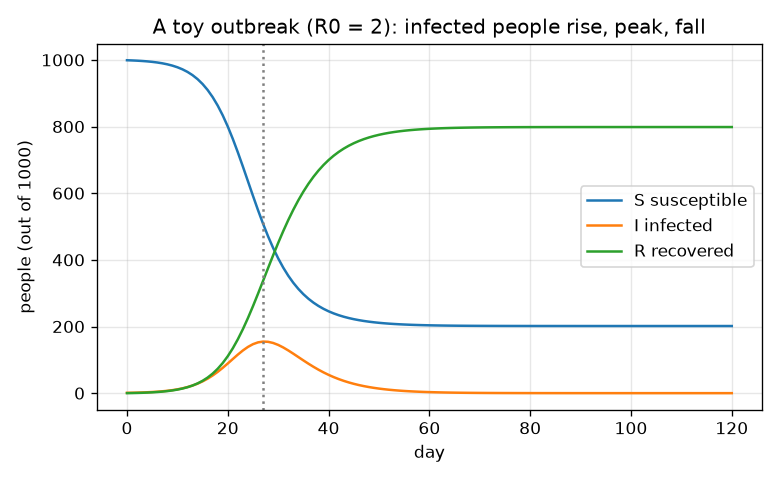

# Session 1: Three boxes with arrows: how an outbreak rises and falls

*Level 1 (conceptual interactive model) · about 60 minutes · openepidemic*

> This is a simplified educational model. It is not a validated design tool and must not be used for real structures, electrical installations, vehicles, industrial processes or medical decisions.

**Prerequisites**

- School arithmetic: multiplication, percentages, ratios.
- You have read PRIMER.md and run `python start.py 1` once.

**Learning objectives.** After this session you can:

- Describe the S, I and R boxes and the two arrows between them.
- Explain why an infection spreads when each case infects more than one other person.
- Read a graph of infected people against time: it rises, peaks and falls.
- Compute and use the number R0 = beta / gamma.

## A. Real-world problem
GENERAL EDUCATION ONLY: this is a toy with invented people. It is not a forecast, not medical advice and not a basis for public-health decisions. When a new infection reaches a town, why does one outbreak explode while another fizzles out? And why does the number of sick people rise, reach a peak, and then fall even though nobody did anything special at the peak? Modellers sort people into three boxes: Susceptible (could catch it), Infected (have it and can pass it on) and Recovered (had it, now immune). Two arrows move people: infection (S to I) and recovery (I to R).

## B. Concept and theory
In a small time step dt (days), the number of new infections is beta times S times I divided by N times dt: it is large when many people are susceptible and many are infectious, because that is when meetings between the two are common. The number of new recoveries is gamma times I times dt: a fixed share of the infected people recovers each day. People only move, so S + I + R = N always. One infected person stays infectious for about 1/gamma days and infects people at rate beta, so infects about beta / gamma others when nearly everybody is susceptible. This number is R0. If R0 is above 1 each case replaces itself with more than one case and the outbreak grows; if it is below 1 the outbreak dies away. The curve of infected people peaks later, when so many people have already recovered that the infected can no longer find enough susceptible people to pass the infection on.

| Symbol | Meaning | Unit |
|---|---|---|
| S, I, R | numbers of susceptible, infected and recovered people | people |
| N | total number of people (S + I + R) | people |
| beta | contact rate: infections caused per infected person per day when everyone is susceptible | 1/day |
| gamma | recovery rate = 1 / (days a person is infectious) | 1/day |
| R0 | basic reproduction number = beta / gamma | no unit |
| dt | time step | days |

**Assumptions**

- Everybody mixes equally with everybody else (a single well-mixed town).
- Recovered people are immune for the whole simulation.
- No births, deaths or travel; N stays fixed.
- Invented numbers only: this is a teaching tool, not a forecast.

$$ \text{new infections}=\beta\,\dfrac{S\,I}{N}\,\Delta t,\qquad \text{new recoveries}=\gamma\,I\,\Delta t $$

$$ S+I+R=N\quad\text{(people only move between boxes)} $$

$$ R_0=\dfrac{\beta}{\gamma}\quad\text{(people infected by one case in a fully susceptible town)} $$

## C. Visual explanation
The first figure draws the S, I and R curves of a town of 1000 people with one starting case, beta = 0.5 and gamma = 0.25 per day (R0 = 2): S falls, R rises, and I rises to a peak on day 27 of about 155 people before falling. The second figure compares three values of beta with the same gamma: with R0 = 2 the infection grows, with R0 = 1 the number of infected people only declines slowly, and with R0 = 0.5 it falls from the first day.

*Infected people for R0 = 2, 1 and 0.5: only R0 above 1 gives an outbreak.*

*S, I and R for a toy town of 1000 people with R0 = 2: the infected curve rises, peaks on day 27 and falls.*

## D. Interactive simulation
Run the lesson (`python start.py 1`), then open the live app: [Session 1: three boxes and the curve](https://krunalpanchal1995.github.io/openepidemic/session-01/) (or `app.html` in this folder). In the app, drag the day slider and watch the boxes fill and empty, then switch to the curves view. Change beta and gamma and watch the peak move.

**Challenge.** Make the outbreak die out from the start by choosing beta and gamma so that R0 is below 1.

## E. Worked example and experiment
**Problem.** A town has N = 1000 people, 999 susceptible and 1 infected. With beta = 0.5 and gamma = 0.25 per day, move the people for one day (dt = 1) and find R0.

1. New infections = 0.5 * 999 * 1 / 1000 * 1 = 0.4995 people.
2. New recoveries = 0.25 * 1 * 1 = 0.25 people.
3. S = 999 - 0.4995 = 998.5005; I = 1 + 0.4995 - 0.25 = 1.2495; R = 0 + 0.25 = 0.25.
4. Check: 998.5005 + 1.2495 + 0.25 = 1000, so nobody was lost.
5. R0 = beta / gamma = 0.5 / 0.25 = 2, so one case infects about 2 others: 1, 2, 4, 8 cases over four generations.

**Answer.** After one day S = 998.5005, I = 1.2495, R = 0.25, and R0 = 2. (With the finer 0.1 day steps used in lesson.py the town on day 10 has S = 978.0, I = 11.4, R = 10.6.)

**Experiment.** Play the spreading game in a class of 20 with dice or coins: each 'infected' person flips a coin for each person they meet, and a head infects that person; after a few rounds, count the three groups and compare with the boxes. Expect a rough rise and then a fall, not the smooth curve: real groups are small and chance matters (Session 3). Model and reality differ because real people do not mix equally, differ in age and behaviour, and cases are counted late.

## F. Assessment and design challenge
**Question type A: Conceptual.** Why does the number of infected people fall after the peak even if nobody changes their behaviour?

Hint

Think about who is left for an infected person to meet.

Step-by-step solution

After the peak so many people have recovered (and are immune) that an infected person meets mostly recovered people, so each case infects fewer than one other. New infections drop below new recoveries, so I falls. The outbreak does not end because the infection runs out of time but because it runs out of susceptible people.

**Question type B: Numerical.** A town has beta = 0.3 and gamma = 0.1 per day. Find R0 and the number of cases in generation 3, starting from one case.

Hint

R0 = beta / gamma; each generation multiplies the number of cases by R0.

Step-by-step solution

R0 = 0.3 / 0.1 = 3. Generations: 1, 3, 9, 27, so generation 3 has 27 cases. Sanity check: R0 above 1, so the numbers grow. Units: R0 has no unit; the cases are people.

**Question type C: Graph and simulation interpretation.** In the S, I, R figure, on which day is the peak, roughly how many people are infected then, and what happens to R at that moment?

Hint

Find the highest point of the I curve and look at the other curves above that day.

Step-by-step solution

The peak is on day 27 with about 155 infected people. At that moment S is falling and R is rising, but the I curve is flat for an instant because new infections equal new recoveries. After that day R keeps rising and I falls.

**Question type D: Design and optimisation challenge.** Design: with gamma = 0.25 per day, the town's contact rate is beta = 0.5. A school-closure plan could reduce beta. What beta makes R0 equal to exactly 1, and what happens if the plan reaches beta = 0.2? State one reason your answer might be too optimistic.

Hint

R0 = beta / gamma, so beta = R0 * gamma.

Step-by-step solution

For R0 = 1 we need beta = 1 * 0.25 = 0.25 per day: halving beta. At beta = 0.2, R0 = 0.8 and the number of infected people falls from the first day. Too optimistic because beta is not a dial we can set: contacts differ between people and groups, the model assumes equal mixing, and a change in behaviour is itself uncertain. This is a classroom exercise, not advice.

Score yourself with [RUBRIC.md](../../RUBRIC.md). Print the [activity sheet](activity_sheet.md) to work on paper.

## Common misconceptions
| Common misconception | What is actually true |
|---|---|
| The outbreak stops because everybody has been infected. | It stops when R0 times the susceptible share drops below 1; some people are never infected (Session 2 computes how many). |
| R0 is a property of the germ alone. | R0 = beta / gamma depends on how people meet (beta) as well as on how long they are infectious (gamma), so it changes with behaviour and place. |
| The peak is when the most people have been infected in total. | The peak is when the most people are infected at the same time; the total keeps rising after it. |
| A model like this can tell us what will happen in a real town. | It is a teaching tool with invented numbers. Real forecasting needs far more care and expert work. |

## Glossary
- **susceptible**: a person who can still catch the infection
- **infected**: a person who has the infection and can pass it on
- **recovered**: a person who had the infection and is now immune (in this model)
- **R0**: basic reproduction number: people infected by one case in a fully susceptible town
- **contact rate beta**: infections caused per infected person per day
- **recovery rate gamma**: 1 / (days infectious)

## Finish
1. Do the three coding tasks in [exercises.md](exercises.md).
2. Run `python start.py 1` again after your changes. It ends with the checkpoint; when it prints `PASS`, you are done. (Checkpoint only: `python start.py check 1`.)

Next: [Session 2](../session-02/README.md)
