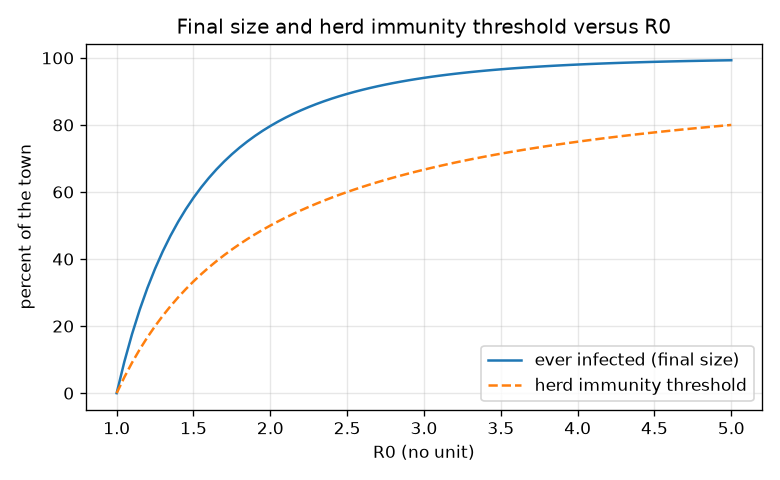
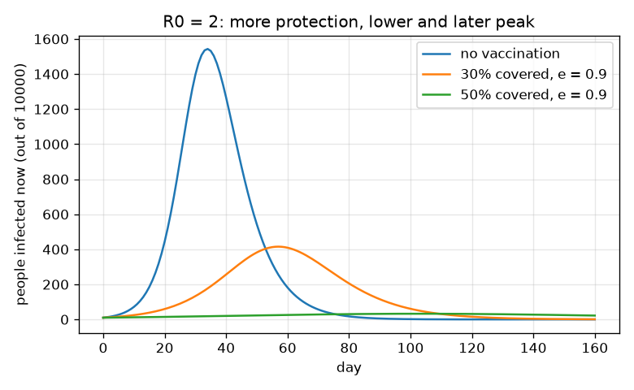

# Session 2: The SIR equations, R0 and herd immunity

*Level 2 (mathematical engineering model) · about 75 minutes · openepidemic*

> This is a simplified educational model. It is not a validated design tool and must not be used for real structures, electrical installations, vehicles, industrial processes or medical decisions.

**Prerequisites**

- Session 1: the S, I, R boxes and R0.
- The idea of a rate of change (slope), and the exponential function exp(x).

**Learning objectives.** After this session you can:

- Write the SIR equations and explain each term and unit.
- Show that the epidemic grows exactly when R0 * S / N is above 1.
- Compute the herd immunity threshold 1 - 1/R0 and the final size from z = 1 - exp(-R0 z).
- Solve a design problem: what vaccination coverage brings the effective reproduction number below 1, and why imperfect protection needs more.

## A. Real-world problem
GENERAL EDUCATION ONLY: teaching model, invented numbers; not a forecast, not medical advice, not a basis for public-health decisions. Before any outbreak, a town can ask two questions of a simple model: how many people would be infected in total if nothing were done, and what share of the town must already be protected so that an infection cannot take off? The first is the final size, the second the herd immunity threshold. Both follow from the SIR equations and one number, R0.

## B. Concept and theory
Turn the boxes of Session 1 into rates of change. People leave S at the rate beta S I / N, the same people enter I, and I loses gamma I people to R. Because S + I + R = N, the three equations add to zero. The infected number grows when dI/dt is positive, that is when beta S / N is above gamma, which is R0 S / N above 1. At the start S is close to N, so growth needs R0 above 1. The effective reproduction number R_eff = R0 S / N falls as S falls; at the peak R_eff = 1. Herd immunity: if a fraction p of the town is protected at the start, R_eff = R0 (1 - p), which is below 1 when p is above 1 - 1/R0. Final size: dividing dS/dt by dR/dt gives dS/dR = -R0 S / N, so S = S0 exp(-R0 R / N); at the end I = 0, so with z the fraction ever infected and S0 close to N, 1 - z = exp(-R0 z). This equation has no closed-form solution, so we solve it with Newton's method. Design: a vaccine with efficacy e protects a fraction e of those vaccinated; with coverage v the protected share is v e, so we need v above (1 - 1/R0) / e. If e is below 1 - 1/R0 this exceeds 100 percent and vaccination alone cannot stop the spread. For an imperfect (leaky) vaccine the same count holds on average: some vaccinated people stay susceptible, so more people must be vaccinated.

| Symbol | Meaning | Unit |
|---|---|---|
| beta | contact rate | 1/day |
| gamma | recovery rate | 1/day |
| R0 | beta / gamma | no unit |
| R_eff | R0 times the susceptible share S / N | no unit |
| z | fraction of the town ever infected (final size) | no unit |
| v | vaccination coverage (share vaccinated) | no unit (0 to 1) |
| e | vaccine efficacy: share of the vaccinated who are protected | no unit (0 to 1) |
| N | population | people |

**Assumptions**

- Well-mixed town, fixed N, no births or deaths.
- Recovered or protected people are fully immune for the whole simulation.
- The outbreak starts with S close to N (a few infected people).
- Vaccination happens before the outbreak and moves people from S to R at the start.
- Teaching model: thresholds are idealised numbers, never targets for a real programme.

$$ \dfrac{dS}{dt}=-\beta\dfrac{S I}{N},\qquad \dfrac{dI}{dt}=\beta\dfrac{S I}{N}-\gamma I,\qquad \dfrac{dR}{dt}=\gamma I $$

$$ R_0=\dfrac{\beta}{\gamma},\qquad \dfrac{dI}{dt}>0\iff R_0\dfrac{S}{N}>1 $$

$$ p_c=1-\dfrac{1}{R_0}\quad\text{(herd immunity threshold)} $$

$$ z=1-e^{-R_0 z}\quad\text{(final size, } S_0\approx N\text{)} $$

$$ v>\dfrac{1-1/R_0}{e}\quad\text{(coverage needed with efficacy } e\text{)} $$

$$ \dfrac{I_{\max}}{N}\approx 1-\dfrac{1+\ln R_0}{R_0} $$

## C. Visual explanation
The first figure shows the infected curve of a town of 10000 people (R0 = 2) with no vaccination and with 30 and 50 percent coverage at efficacy 0.9: the peak falls from 1543 to 415 to 33 people and arrives later. The second figure plots the final size and the herd immunity threshold against R0; both rise with R0, the final size much faster, reaching 94.0 percent at R0 = 3, while the threshold is 66.7 percent.

*Final size and herd immunity threshold against R0.*

*Infected people for R0 = 2 with 0, 30 and 50 percent vaccination coverage (efficacy 0.9): lower and later peaks.*

## D. Interactive simulation
Run the lesson (`python start.py 2`), then open the live app: [Session 2: SIR, herd immunity and coverage](https://krunalpanchal1995.github.io/openepidemic/session-02/) (or `app.html` in this folder). In the app, change R0 and watch the S, I, R curves; then switch to the bar view and move coverage and efficacy until the filled bar passes the red threshold line. Open the final-size view and see the coverage needed.

**Challenge.** Choose R0 = 3, then coverage and efficacy so that R_eff = R0 (1 - v e) is below 1.

## E. Worked example and experiment
**Problem.** (a) For R0 = 3 find the herd immunity threshold. (b) For R0 = 2 check that z = 0.797 is the final size. (c) Find the coverage needed for R0 = 3 when the vaccine efficacy is 0.9.

1. (a) p_c = 1 - 1/3 = 0.667, that is 66.7 percent of the town.
2. (b) Evaluate the right-hand side at z = 0.797: 1 - exp(-2 * 0.797) = 1 - exp(-1.594) = 1 - 0.203 = 0.797. The two sides agree, so z = 0.797: about 79.7 percent of the town is ever infected.
3. (c) v > 0.667 / 0.9 = 0.741, that is 74.1 percent.
4. Check (c): protected share = 0.741 * 0.9 = 0.667; R_eff = 3 * (1 - 0.667) = 1.

**Answer.** (a) 66.7 percent. (b) about 79.7 percent are ever infected. (c) 74.1 percent coverage. Imperfect protection raises the coverage needed from 66.7 to 74.1 percent; with efficacy 0.6 it would be 111 percent, which is impossible.

**Experiment.** Repeat the dice game from Session 1 but give some players a 'protected' card before the game starts: protected players cannot be infected. Compare the final counts for 0, 3 and 6 protected players out of 20. The curve should lower and the total fall, but with only 20 players chance blurs the pattern. Real outbreaks differ from the model because contacts are uneven (some people meet far more people than others), immunity wanes, and the vaccinated are not a random sample of the town.

## F. Assessment and design challenge
**Question type A: Conceptual.** Explain in words why the herd immunity threshold is 1 - 1/R0 and why a larger R0 needs a larger share protected.

Hint

Each case must infect fewer than one other person; what share of contacts must be with protected people?

Step-by-step solution

Each case meets people at random; a fraction p of them are protected and cannot be infected. So a case infects R0 (1 - p) people. The outbreak cannot grow when this is below 1, which gives 1 - p < 1/R0, i.e. p > 1 - 1/R0. A larger R0 means each case would infect more people, so a larger share of contacts must be blocked.

**Question type B: Numerical.** R0 = 4. Find the herd immunity threshold. With a vaccine of efficacy 0.8, what coverage is needed?

Hint

p_c = 1 - 1/R0 and v = p_c / e.

Step-by-step solution

p_c = 1 - 1/4 = 0.75, that is 75 percent. v = 0.75 / 0.8 = 0.9375, about 93.8 percent. Check: protected share 0.9375 * 0.8 = 0.75, R_eff = 4 * 0.25 = 1. Units: shares have no unit; multiply by 100 for percent.

**Question type C: Graph and simulation interpretation.** In the vaccination figure, how do the peak height and peak day change as coverage goes from 0 to 30 to 50 percent? What does this tell you about R_eff?

Hint

Compare the three curves; compute R_eff = 2 (1 - 0.9 v) for each.

Step-by-step solution

The peak falls from 1543 to 415 to 33 people and arrives later. R_eff at the start is 2, 1.46 and 1.10: still above 1, so the infection still grows, but slowly, and fewer susceptible people are available. Coverage below the threshold reduces and delays the peak; it does not remove the outbreak.

**Question type D: Design and optimisation challenge.** Design: for R0 = 3 the town can only buy a vaccine with efficacy 0.6. Is vaccination alone enough to stop the infection spreading? What combination of measures could work, and what assumption does your answer rely on?

Hint

Compute the coverage needed; if it is above 100 percent, what else must change?

Step-by-step solution

Needed coverage = 0.667 / 0.6 = 1.11, which is 111 percent, impossible: even vaccinating everyone protects only 60 percent, below the 66.7 percent threshold. So R_eff stays above 1 (3 * 0.4 = 1.2). A second measure must also reduce beta (or R0) by at least a factor of 1.2: then the effective R0 would be 2.5 or lower and the threshold 60 percent, which full coverage just reaches. The answer relies on equal mixing, a perfect random vaccination and a fixed efficacy. This is a classroom exercise, not advice.

Score yourself with [RUBRIC.md](../../RUBRIC.md). Print the [activity sheet](activity_sheet.md) to work on paper.

## Common misconceptions
| Common misconception | What is actually true |
|---|---|
| Herd immunity means everybody must be protected. | Only a share 1 - 1/R0 must be protected for the infection to stop growing; for R0 = 3 that is 66.7 percent. |
| An outbreak without vaccination infects everybody. | The final size equation gives 79.7 percent for R0 = 2 and 94.0 percent for R0 = 3: some people always escape. |
| The infection ends exactly when R_eff reaches 1. | R_eff = 1 is the peak; the infection keeps spreading to more people afterwards (overshoot), which is why the final size is above the herd immunity threshold. |
| An imperfect vaccine only needs the same coverage. | Efficacy below 1 means some vaccinated people stay susceptible, so coverage must be divided by the efficacy. |

## Glossary
- **R_eff**: effective reproduction number: R0 times the susceptible share
- **herd immunity threshold**: protected share above which R_eff is below 1 at the start
- **final size**: fraction of the town ever infected by the end of the outbreak
- **efficacy**: share of the vaccinated who are protected
- **Newton's method**: a repeated guess-and-improve method that solves an equation numerically
- **coverage**: share of the town that was vaccinated

## Finish
1. Do the three coding tasks in [exercises.md](exercises.md).
2. Run `python start.py 2` again after your changes. It ends with the checkpoint; when it prints `PASS`, you are done. (Checkpoint only: `python start.py check 2`.)

Next: [Session 3](../session-03/README.md)
