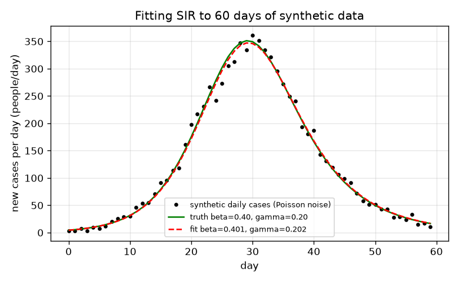
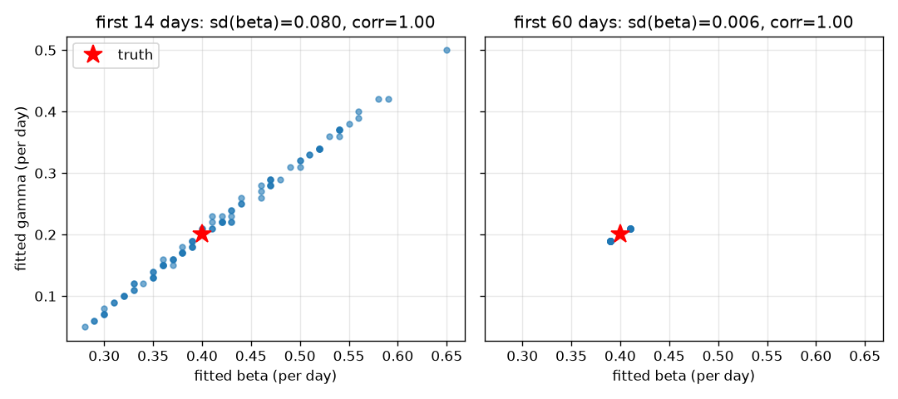
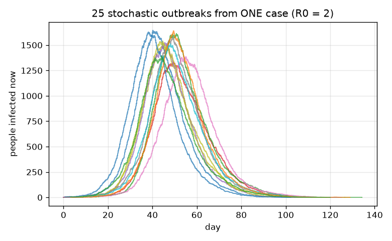
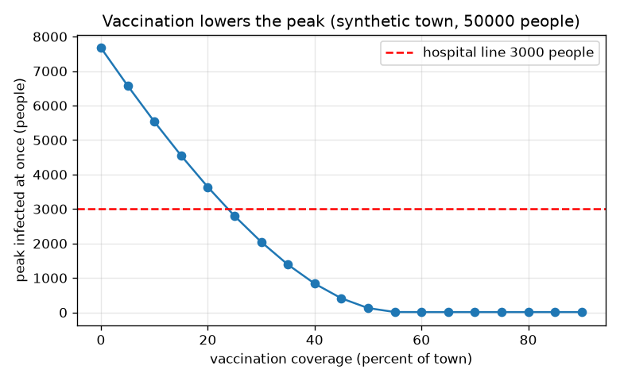

# Session 3: Simulate, fit and test: SIR with data, chance and vaccination

*Level 3 (simulation and validation) · about 90 minutes · openepidemic*

> This is a simplified educational model. It is not a validated design tool and must not be used for real structures, electrical installations, vehicles, industrial processes or medical decisions.

**Prerequisites**

- Session 2: the SIR equations, R0, final size.
- Session 2's idea of slope; basic ideas of mean and standard deviation. Python arrays (numpy).

**Learning objectives.** After this session you can:

- Write and validate your own RK4 solver against conservation, the final-size equation and the early growth rate.
- Fit beta and gamma to synthetic noisy case counts by least squares and measure the uncertainty by repeating the experiment.
- Show that early data cannot separate beta from gamma, and explain the failure cases (fitting before the peak, reporting delays).
- Use a stochastic simulation to show that small outbreaks die out with probability about 1/R0, and use the model to choose a vaccination coverage under a capacity line.

## A. Real-world problem
GENERAL EDUCATION ONLY: every data set in this session is invented. The model is a teaching tool, not a forecast, not medical advice and not a basis for public-health decisions. Case counts arrive as noisy daily numbers. A modeller asks: which contact rate beta and recovery rate gamma reproduce them, how sure are we, and what would vaccinating part of the town first do to the peak? Two traps wait: data from before the peak hardly constrain the answer, and reporting delays shift the whole picture. And one more surprise: with a single starting case, an outbreak can simply die out by luck.

## B. Concept and theory
Numerical solution: RK4 advances (S, I, R) over a step h using four slopes k1 to k4 and the weighted average (k1 + 2 k2 + 2 k3 + k4) / 6; its error falls with the fourth power of h. We validate it against three trusted results: S + I + R = N, the final size equation z = 1 - exp(-R0 z), and the early exponential growth I ~ exp(r t) with r = gamma (R0 - 1) (found by linearising dI/dt for S close to N). Synthetic data: the expected number of new infections on day k is S(k) - S(k+1); each day's reported count is a Poisson random number with that mean. Fitting: least squares chooses (beta, gamma) to minimise the sum of squared differences between model and data. We use a grid search and then Gauss-Newton, which linearises the model with its Jacobian matrix J and gives the covariance of the estimates, s^2 (J^T J)^(-1). Because many data sets from the same truth give a spread of estimates, repeating the experiment measures the uncertainty. Identifiability: early on the data are mostly exponential growth, which fixes the difference beta - gamma but not beta and gamma separately, so the two estimates move together (correlation near 1). Chance: the Gillespie method draws random waiting times, with infection events at rate beta S I / N and recovery events at rate gamma I. For one starting case in a large town the number of cases early on behaves as a branching process whose extinction probability is gamma / beta = 1/R0. Vaccination before the outbreak moves v e N people from S to R.

| Symbol | Meaning | Unit |
|---|---|---|
| h | RK4 step size | days |
| r | early exponential growth rate = gamma (R0 - 1) | 1/day |
| J | Jacobian: derivative of model daily cases with respect to beta and gamma | people/day per (1/day) |
| s^2 | residual variance of the fit | people^2/day^2 |
| P_ext | probability that an outbreak from one case dies out | no unit |
| v, e | coverage and efficacy | no unit |
| peak | largest number infected at once | people |

**Assumptions**

- All data are synthetic, generated from a known truth (beta 0.4, gamma 0.2, N 10000, 10 starting cases).
- N and the starting cases are known; only beta and gamma are fitted.
- Reported daily cases equal new infections plus Poisson noise unless a delay is added.
- Single well-mixed town; vaccination is applied before the outbreak and is all-or-nothing for the protected share v e.
- Teaching model: no age groups, no behaviour change, no real-world use.

$$ \mathbf y_{n+1}=\mathbf y_n+\dfrac{h}{6}\left(\mathbf k_1+2\mathbf k_2+2\mathbf k_3+\mathbf k_4\right) $$

$$ I(t)\approx I_0\,e^{r t},\qquad r=\gamma(R_0-1)=\beta-\gamma $$

$$ \min_{\beta,\gamma}\ \sum_k\left(c_k-m_k(\beta,\gamma)\right)^2,\qquad \Delta\theta=\left(J^{\mathsf T}J\right)^{-1}J^{\mathsf T}(c-m),\qquad \mathrm{Cov}\approx s^2\left(J^{\mathsf T}J\right)^{-1} $$

$$ P_{\mathrm{ext}}\approx \dfrac{1}{R_0}=\dfrac{\gamma}{\beta}\quad\text{(one starting case, large town, } R_0>1\text{)} $$

$$ R_{\mathrm{eff}}=R_0\,(1-v\,e) $$

## C. Visual explanation
Figure 1 shows 60 days of noisy synthetic daily cases, the true curve and the fitted curve, which lie almost on top of each other (fitted beta 0.401, gamma 0.201). Figure 2 is the key picture of identifiability: 100 repeated fits scatter along a narrow diagonal band when only 14 days of data are used (standard deviation 0.080 for beta) and cluster tightly around the true point when 60 days are used (0.006). Figure 3 shows 25 stochastic outbreaks from one case: about half never take off. Figure 4 plots the peak against vaccination coverage in a synthetic town of 50000 people, with a dashed hospital line at 3000 people.

*Synthetic noisy daily cases, the true curve and the fitted curve over 60 days.*

*100 repeated fits: with 14 days of data beta and gamma scatter along a diagonal; with 60 days they are tight.*

*25 stochastic outbreaks from one case at R0 = 2: some die out by chance.*

*Peak infected at once against vaccination coverage in a synthetic town of 50000, with the hospital line.*

## D. Interactive simulation
Run the lesson (`python start.py 3`), then open the live app: [Session 3: vaccination and the hospital line](https://krunalpanchal1995.github.io/openepidemic/session-03/) (or `app.html` in this folder). In the app, set beta and gamma, then raise the vaccination coverage and watch the peak shrink below the red hospital line. Compare the grey curve (no vaccination) with the blue one. Open the peak-versus-coverage view to read the smallest coverage that passes.

**Challenge.** Set beta = 0.4 and gamma = 0.2 and choose a coverage so that R_eff = R0 (1 - 0.9 v) is below 1.

## E. Worked example and experiment
**Problem.** A synthetic town of 50000 people has 10 infected people, beta = 0.4, gamma = 0.2 per day and a vaccine with efficacy 0.9. Its hospital line is 3000 people infected at once. Find the smallest whole-percent coverage that keeps the peak under the line.

1. R0 = 0.4 / 0.2 = 2. Without vaccination the RK4 simulation gives a peak of 7676 people, far over the line.
2. Protected share = coverage * 0.9. At 23 percent coverage the protected share is 20.7 percent: R_eff = 2 * (1 - 0.207) = 1.59 and the simulated peak is 3125 people, still over the line.
3. At 24 percent coverage the protected share is 21.6 percent: R_eff = 1.57 and the peak is 2961 people, under the line.
4. Note that R_eff is far above 1 in both cases: the line is kept not by stopping the outbreak but by flattening it.

**Answer.** The smallest passing coverage is 24 percent (peak 2961 people); 23 percent fails (3125). Sensitivity: with beta 10 percent lower (0.36) the answer is 17 percent, with beta 10 percent higher (0.44) it is 31 percent, and a vaccine with efficacy 0.6 needs 36 percent. A 10 percent error in beta moves the answer a lot, so a real plan would need a large margin; this is a classroom exercise only.

**Experiment.** Hands-on: take any freely available, clearly historical case-count series for a past outbreak and try to fit SIR to the first 14 days and then to the whole series; compare the two fitted pairs and curves. Expect the early-data fit to be unstable and the full fit to follow the curve but with systematic misfits. The model differs from reality because real mixing is uneven, behaviour changes during an outbreak, reporting is delayed and incomplete, and there are many more states than S, I and R.

## Real-world application and mini-project: Keep a synthetic town under its hospital line
GENERAL EDUCATION ONLY: the town is invented and the answer is a classroom exercise, never advice for a real place. A synthetic town of 50000 people has 10 infected people, beta = 0.4 and gamma = 0.2 per day (R0 = 2), and a vaccine with efficacy 0.9. Its hospital line is 3000 people infected at once. Use `peak_with_vaccination` and `min_coverage_for_peak` from Session 3 to find the smallest whole-percent coverage that keeps the peak under the line, then test how fragile your answer is.

**Deliverable:** A script that prints the peak for coverages 0, 5, 10, ... 60 percent, names the smallest passing coverage, repeats the search for beta = 0.36 and beta = 0.44 (a 10 percent error in beta) and for efficacy 0.6, and saves a plot of peak against coverage with the hospital line.

**Success looks like:** The smallest passing coverage is reported as 24 percent (23 percent gives a peak of 3125 people, 24 percent gives 2961), and the sensitivity runs report 17 percent for beta = 0.36, 31 percent for beta = 0.44 and 36 percent for efficacy 0.6. A short note says why a margin above 24 percent is sensible and why none of this applies to a real town.

## F. Assessment and design challenge
**Question type A: Conceptual.** Why can the first two weeks of data fix the growth rate beta - gamma well but not beta and gamma separately?

Hint

During the exponential phase I(t) is proportional to exp((beta - gamma) t). What do two different pairs with the same difference look like?

Step-by-step solution

In the early phase new cases grow like exp(r t) with r = beta - gamma, so the data mostly measure r. Pairs such as (0.4, 0.2) and (0.48, 0.29) give almost the same growth rate (0.20 and 0.19), so the curves are nearly identical for two weeks: the sum of squared differences between them over 14 days is only 40 people^2, well inside the noise (the Poisson variance of the 14 counts adds up to 296 people^2), whereas over 60 days it is 55941 people^2 and the pairs are easy to tell apart. The estimates move together (correlation near 1). The curves only differ later, near and after the peak, when gamma controls how fast people leave I and beta controls how fast S is used up.

**Question type B: Numerical.** A fit to the first 14 days of the seed-1000 data gives beta = 0.477 and gamma = 0.288. Compute R0 and beta - gamma, and compare both with the truth (beta 0.4, gamma 0.2).

Hint

R0 = beta / gamma, growth rate = beta - gamma.

Step-by-step solution

R0 = 0.477 / 0.288 = 1.66 against the true 2.0: about 17 percent low. beta - gamma = 0.477 - 0.288 = 0.189 against the true 0.2: only 5.5 percent low. The growth rate is far better determined than R0, which is the identifiability problem in numbers. (The standard errors of that fit are 0.10 and 0.12.)

**Question type C: Graph and simulation interpretation.** In Figure 2, compare the left panel (14 days) and the right panel (60 days). What does the diagonal shape mean, and what should a modeller conclude from it?

Hint

Look at the width of the cloud along and across the diagonal.

Step-by-step solution

The cloud on the left is long along the diagonal and thin across it: beta and gamma can both be much too high or much too low together, as long as their difference is about 0.2. The standard deviations of the estimates are 0.080 (beta) and 0.097 (gamma) but the standard deviation of beta - gamma is only 0.018. On the right (60 days) the cloud is a tiny blob (0.006). A modeller should not quote beta or R0 from early data without wide error bars, and should report the well-determined combination.

**Question type D: Design and optimisation challenge.** Design: the hospital line is 1000 people for the synthetic town of the worked example (efficacy 0.9, beta 0.4, gamma 0.2). Find the smallest coverage, then say what margin you would add if beta is uncertain by 10 percent, and state one trade-off.

Hint

Use min_coverage_for_peak(1000), then repeat with beta = 0.44.

Step-by-step solution

The smallest passing coverage for the 1000 line is 39 percent. Because the answer for 3000 changes from 24 to 31 percent when beta is 10 percent higher, a margin of at least a few percentage points above the nominal answer is sensible; also the true efficacy is uncertain. Trade-off: more coverage costs more and cannot exceed 100 percent, while a smaller margin risks exceeding capacity. This is a classroom exercise; real decisions need expert, much more detailed analysis.

Score yourself with [RUBRIC.md](../../RUBRIC.md). Print the [activity sheet](activity_sheet.md) to work on paper.

## Common misconceptions
| Common misconception | What is actually true |
|---|---|
| A good fit proves the parameters are right. | Different (beta, gamma) pairs can fit early data equally well; only the repeats and the correlation reveal this. |
| Fitting before the peak is the most useful, because it predicts the future. | It is the least reliable: before the peak the data only fix the growth rate. After the peak the fit is easy and tight, but then the future is mostly known. |
| If R0 is above 1 every outbreak takes off. | With one starting case, about 1/R0 of outbreaks die out by chance (50 percent for R0 = 2). |
| Reporting delays only shift the curve in time. | If you ignore a delay, the fit compensates with wrong beta and gamma (a 5-day delay gave beta 0.308 and gamma 0.128 against truth 0.4 and 0.2). |

## Glossary
- **RK4**: fourth-order Runge-Kutta: a standard accurate method to solve differential equations step by step
- **least squares**: choose the parameters that make the sum of squared errors smallest
- **Gauss-Newton**: iterative least-squares method that uses the model's slopes (Jacobian)
- **Jacobian**: matrix of derivatives of the model outputs with respect to the parameters
- **identifiability**: whether the data can separate the parameters
- **Gillespie method**: exact stochastic simulation with random waiting times between events
- **Poisson noise**: random counting noise whose variance equals its mean
- **synthetic data**: data made by a model with known parameters, used to test methods

## Finish
1. Do the three coding tasks in [exercises.md](exercises.md).
2. Run `python start.py 3` again after your changes. It ends with the checkpoint; when it prints `PASS`, you are done. (Checkpoint only: `python start.py check 3`.)

Next: the [roadmap](../../promo/roadmap.md). Session 4 is yours to build.
